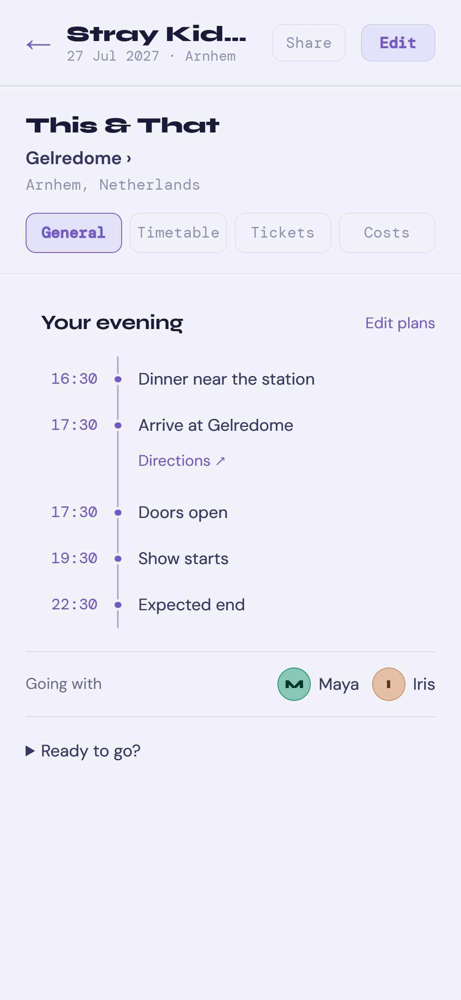
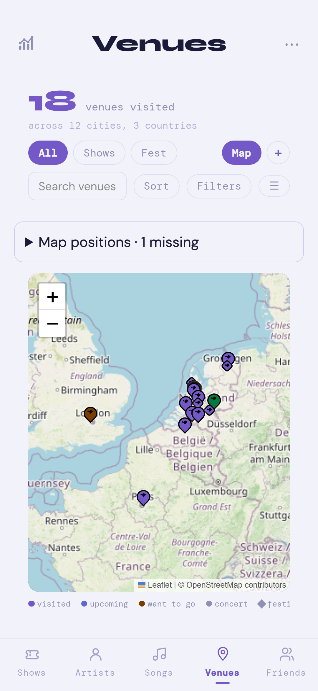

  

  
  
  

  Track every concert and festival you've ever been to. 
  Rate the nights, log the setlists, see your stats, remember who you went with.

  
  
  
  
  

## What it does

- **Log every show**: concerts, festivals and livestreams, past or still to come
- **Keep the setlist**: import it and see which songs you've heard live the most
- **Remember the night**: rating, photo, ticket and merch costs, notes
- **Know your people**: who you went with, and how your tastes overlap
- **See the patterns**: shows per year, genres, venues on a map, money spent
- **Take it with you**: installs on your phone like an app and works offline

## Start your log

All you need is a browser and an email address.

1. Open **[settracker-theta.vercel.app](https://settracker-theta.vercel.app/)**
2. Enter your email, tap **Email me a link**, and tap the link in your inbox
3. Tap **+** to add your first show

Just looking? Tap **Try the demo** on the first screen instead; no account needed. To keep the app on your phone, choose **Add to Home screen** from your browser's menu.

## How much control do you want?

1. **Use the shared app.** Sign in and go; I look after the hosting, the database and the updates. The catch: if the shared database is asleep or I stop running it, you can't get in until it's back.
2. **Run your own copy.** One button puts the app on your own free Vercel and Supabase accounts, so it keeps working whatever happens to mine. You keep your own database awake, and my later updates don't reach it.
3. **Run your own fork.** The same, but linked to this repository: pull in updates with one click and change the code as you like.

You can move between them at any time with a complete backup from one and a restore in the other. The [Setup guide](https://github.com/HoltropAF/concert_tracker/wiki/Setup-guide) walks through levels 2 and 3 in about twenty minutes, with no coding, and the [Developer guide](https://github.com/HoltropAF/concert_tracker/wiki/Developer-guide) takes it from there. settracker is open source under the [MIT licence](LICENSE).

## Learn more

The [wiki](https://github.com/HoltropAF/concert_tracker/wiki) has the rest: [getting started and backups](https://github.com/HoltropAF/concert_tracker/wiki/Using-the-app), everything the app can do in [Features](https://github.com/HoltropAF/concert_tracker/wiki/Features), and [troubleshooting](https://github.com/HoltropAF/concert_tracker/wiki/Troubleshooting).

Found a bug or have an idea? [Open an issue](https://github.com/HoltropAF/concert_tracker/issues).

---

  Built by <a href="https://www.threads.com/@annuhfloor">@annuhfloor</a> with React, Vite, Supabase and Vercel. 
  Setlists from <a href="https://www.setlist.fm">setlist.fm</a>, maps from <a href="https://www.openstreetmap.org">OpenStreetMap</a>.

