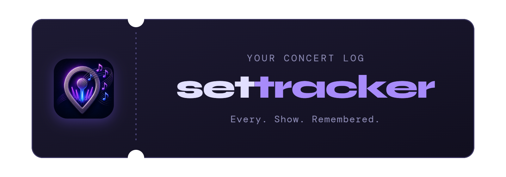
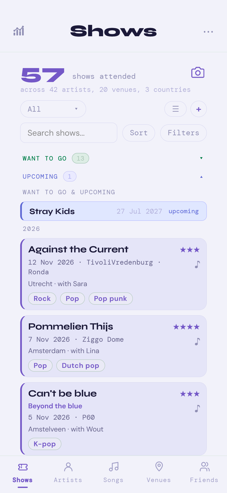
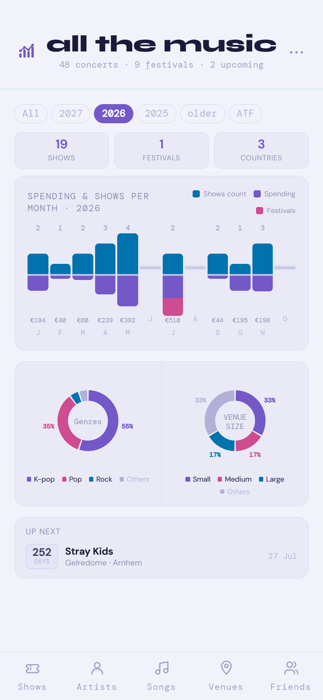
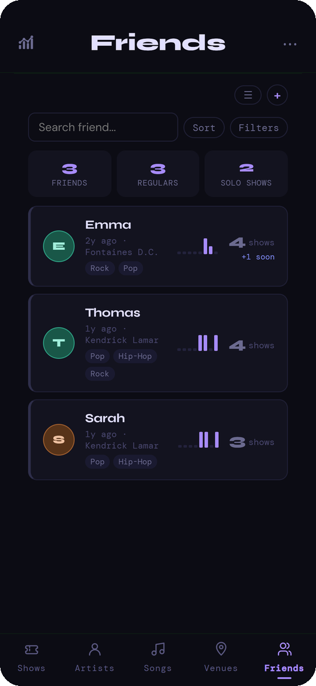

  

  
  
  

  Track every concert and festival you've ever been to. 
  Rate the nights, log the setlists, see your stats, remember who you went with.

  
  
  
  

## What it does

- **Log every show**: concerts, festivals and livestreams, past or still to come
- **Keep the setlist**: import it and see which songs you've heard live the most
- **Remember the night**: rating, photo, ticket and merch costs, notes
- **Know your people**: who you went with, and how your tastes overlap
- **See the patterns**: shows per year, genres, venues on a map, money spent
- **Take it with you**: installs on your phone like an app and works offline

## Start your log

All you need is a browser and an email address.

1. Open **[settracker-theta.vercel.app](https://settracker-theta.vercel.app/)**
2. Enter your email, tap **Email me a link**, and tap the link in your inbox
3. Tap **+** to add your first show

Just looking? Tap **Try the demo** on the first screen instead; no account needed. To keep the app on your phone, choose **Add to Home screen** from your browser's menu.

## Your own copy

settracker is open source. The [Setup guide](https://github.com/HoltropAF/concert_tracker/wiki/Setup-guide) gets you your own version, with your own database and web address, in three steps and about twenty minutes, with no coding. If you want to change the code or help build it, continue with the [Developer guide](https://github.com/HoltropAF/concert_tracker/wiki/Developer-guide).

## Learn more

The [wiki](https://github.com/HoltropAF/concert_tracker/wiki) has the rest: a tour of the [features](https://github.com/HoltropAF/concert_tracker/wiki/Features), everyday [how-tos](https://github.com/HoltropAF/concert_tracker/wiki/Using-the-app), [backups](https://github.com/HoltropAF/concert_tracker/wiki/Backing-up-your-data), [troubleshooting](https://github.com/HoltropAF/concert_tracker/wiki/Troubleshooting), and [how it all works](https://github.com/HoltropAF/concert_tracker/wiki/How-it-works) behind the scenes.

Found a bug or have an idea? [Open an issue](https://github.com/HoltropAF/concert_tracker/issues).

---

  Built by <a href="https://www.threads.com/@annuhfloor">@annuhfloor</a> with React, Vite, Supabase and Vercel. 
  Setlists from <a href="https://www.setlist.fm">setlist.fm</a>, maps from <a href="https://www.openstreetmap.org">OpenStreetMap</a>.

