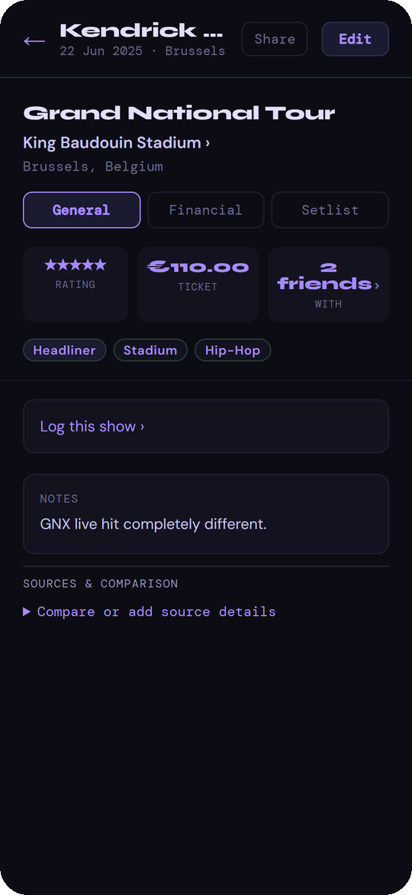
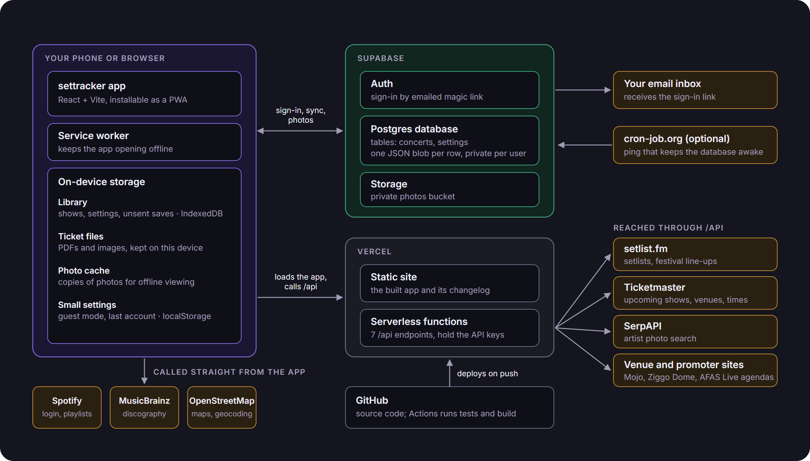

  

  
  
  

  Track every concert and festival you've ever been to. 
  Rate the nights, log the setlists, see your stats, remember who you went with.

---

## Tonight's setlist

1. [Opener](#opener-what-it-does) — what it does
2. [Soundcheck](#soundcheck-try-it-in-30-seconds) — try it in 30 seconds
3. [Main set](#main-set-start-your-own-log) — start your own log
4. [Encore](#encore-the-wiki) — the wiki, for everything else
5. [Merch table](#merch-table) — credits and links

---

## Opener: what it does

  
  
  
  

- **Log every show**: concerts, festivals and livestreams, past or still to come
- **Keep the setlist**: import it and see which songs you've heard live the most
- **Remember the night**: rating, photo, ticket and merch costs, notes
- **Know your people**: who you went with, and how your tastes overlap
- **See the patterns**: shows per year, genres, venues on a map, money spent
- **Take it with you**: installs on your phone like an app and works offline

The full tour is on the [Features](https://github.com/HoltropAF/concert_tracker/wiki/Features) page.

## Soundcheck: try it in 30 seconds

Open **[settracker-theta.vercel.app](https://settracker-theta.vercel.app/)** and tap **Try the demo**. No account needed, and it comes with sample concerts to poke around in.

## Main set: start your own log

Never done anything like this before? Good, this is written for you. All you need is a browser and an email address.

| | |
|---|---|
| **1** | Open [settracker](https://settracker-theta.vercel.app/) |
| **2** | Enter your email and tap **Email me a link** |
| **3** | Tap the link in your inbox. That's your private concert log. |
| **4** | Tap **+** and add your first show |
| **5** | Put it on your home screen: on Android, Chrome menu → **Add to Home screen**; on iPhone, Share → **Add to Home Screen** |

Use the same email on any other device and your shows are there too.

> **Want your own copy instead?** The [Setup guide](https://github.com/HoltropAF/concert_tracker/wiki/Setup-guide) gets you your own settracker in three steps and about twenty minutes, with no coding. If you want to tweak the code or help build it, the [Developer guide](https://github.com/HoltropAF/concert_tracker/wiki/Developer-guide) takes it from there.

## Encore: the wiki

Everything else lives in the [wiki](https://github.com/HoltropAF/concert_tracker/wiki):

| Page | For when you want to |
|---|---|
| [Features](https://github.com/HoltropAF/concert_tracker/wiki/Features) | see everything the app can do |
| [Using the app](https://github.com/HoltropAF/concert_tracker/wiki/Using-the-app) | add shows and festivals, import setlists |
| [Setup guide](https://github.com/HoltropAF/concert_tracker/wiki/Setup-guide) | get your own copy with as little hassle as possible |
| [How it works](https://github.com/HoltropAF/concert_tracker/wiki/How-it-works) | see the full system map: where your data lives and how the code is organised |
| [Developer guide](https://github.com/HoltropAF/concert_tracker/wiki/Developer-guide) | change the code or help improve settracker |
| [Backing up your data](https://github.com/HoltropAF/concert_tracker/wiki/Backing-up-your-data) | export and restore your shows |
| [Keeping your database alive](https://github.com/HoltropAF/concert_tracker/wiki/Keeping-your-database-alive) | stop a free database from going to sleep |
| [Personalising your copy](https://github.com/HoltropAF/concert_tracker/wiki/Personalising-your-copy) | change the links and sample data in your own copy |
| [Troubleshooting](https://github.com/HoltropAF/concert_tracker/wiki/Troubleshooting) | fix something that went wrong |

### Backstage: how it fits together

  

The app runs in your browser and keeps a copy of your shows on the device, so it works offline. The full map, with where every kind of data lives, is on the [How it works](https://github.com/HoltropAF/concert_tracker/wiki/How-it-works) page.

Found a bug or have an idea? [Open an issue](https://github.com/HoltropAF/concert_tracker/issues).

## Merch table

Built by [@annuhfloor](https://www.threads.com/@annuhfloor) with React, Vite, Supabase and Vercel.

Setlists come from [setlist.fm](https://www.setlist.fm), maps from [OpenStreetMap](https://www.openstreetmap.org).

Fork it, rename it, make it yours.
